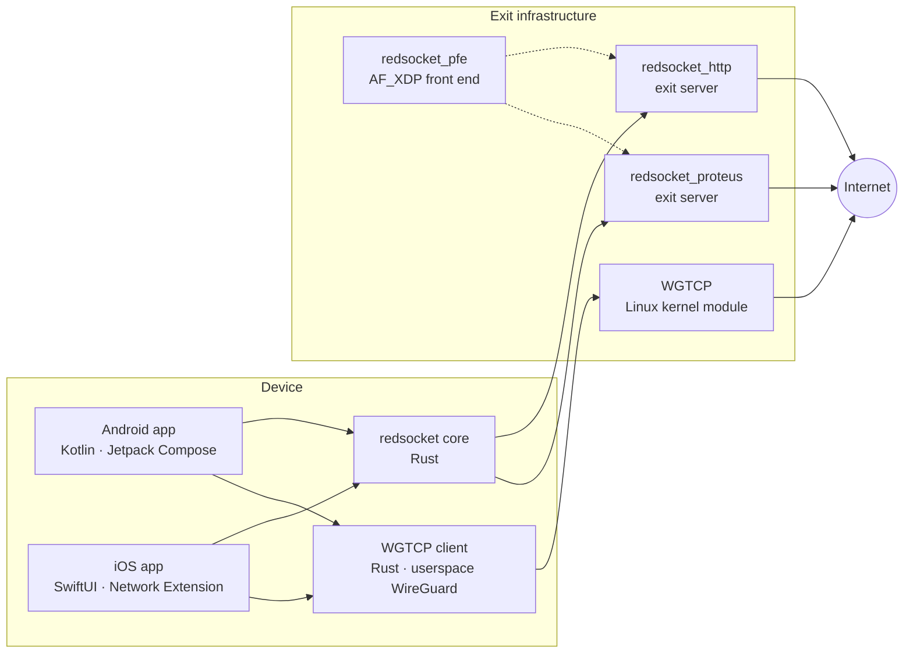

  

<h1 align="center">RostamVPN</h1>

<b>Open-source VPN engineering for networks that fight back.</b> 
Clients, cores, carriers and exit servers. The interesting parts are in the code.

  
  
  
  
  

---

## How it fits together

Two apps share one set of Rust cores. The cores speak to two families of exit server, and a WireGuard-over-TCP protocol runs beside them with a kernel implementation on the server and a userspace one on the device.

| Repository | What it is |
|---|---|
| [rostamvpn-android](https://github.com/RostamVPN/rostamvpn-android) | The Android client and the Rust cores it loads over JNI. |
| [rostamvpn_ios](https://github.com/RostamVPN/rostamvpn_ios) | The iOS client and its packet-tunnel Network Extension, on the same cores. |
| [redsocket_http](https://github.com/RostamVPN/redsocket_http) | The exit server behind an HTTP carrier. |
| [redsocket_proteus](https://github.com/RostamVPN/redsocket_proteus) | The exit server behind Proteus programmable protocols, and nothing else. |
| [redsocket_wgtcp](https://github.com/RostamVPN/redsocket_wgtcp) | Userspace WireGuard-over-TCP client library and tools. No kernel module, no TUN, no root. |
| [WGTCP](https://github.com/RostamVPN/WGTCP) | TCP transport patch for the Linux WireGuard kernel module, with the `wg` fork and Debian DKMS packaging. |
| [redsocket_pfe](https://github.com/RostamVPN/redsocket_pfe) | AF_XDP direct-server-return front end: triangle routing in front of the exits. |
| [sec-audit](https://github.com/RostamVPN/sec-audit) | Penetration test reports for all of the above, published with fix notes. |

## Principles

- **Encrypted end-to-end inside every carrier.** The redsocket servers run a Noise NK session inside the carrier; WGTCP carries WireGuard's own handshake and transport over persistent TCP connections.
- **One tunnel, many carriers.** The same core and the same tunnel protocol sit behind `redsocket_http` and `redsocket_proteus`. What the bytes look like on the wire is the carrier's business, not the tunnel's.
- **Programmable wire formats.** With Proteus, a protocol specification file decides the shape of the traffic and the interpreter runs the tunnel unchanged underneath.
- **Kernel-grade WireGuard where UDP cannot go.** WGTCP keeps WireGuard's keys, peers, `AllowedIPs`, rekeying and administration model and adds a TCP carrier to the kernel module.
- **Tested by adversaries, in public.** Every component went through a white-box penetration test with dynamic testing; the reports are published, open items included.

<b>Under the hood</b>: stack, licences, audit reports and build notes per repository

 

| Repository | Stack | Licence | Audit report | Notes |
|---|---|---|---|---|
| rostamvpn-android | Kotlin, Rust, Python | Apache-2.0 | [WP3](https://github.com/RostamVPN/sec-audit/blob/main/WP3-rostamvpn-android/PENTEST-REPORT.md) · [PDF](https://github.com/RostamVPN/sec-audit/blob/main/WP3-rostamvpn-android/PENTEST-REPORT.pdf) | `VpnService` TUN to the core's local SOCKS5 port through `hev-socks5-tunnel`; the WGTCP core ships as a second protocol; Gradle resolves from an in-tree Maven mirror, so the app builds offline. |
| rostamvpn_ios | Swift, C, Shell | Apache-2.0 | [WP4](https://github.com/RostamVPN/sec-audit/blob/main/WP4-rostamvpn-ios/PENTEST-REPORT.md) · [PDF](https://github.com/RostamVPN/sec-audit/blob/main/WP4-rostamvpn-ios/PENTEST-REPORT.pdf) | SwiftUI app plus an `NEPacketTunnelProvider` extension; the Rust cores arrive as xcframeworks built from the Android tree. |
| redsocket_http | Rust | Apache-2.0 | [WP1](https://github.com/RostamVPN/sec-audit/blob/main/WP1-redsocket_http/PENTEST-REPORT.md) · [PDF](https://github.com/RostamVPN/sec-audit/blob/main/WP1-redsocket_http/PENTEST-REPORT.pdf) | HTTP Upgrade, then Noise NK, then CONNECT for TCP and relay for UDP. Modules: egress-IP pinning, deny lists, signed exit-side blocking bundle, client mailboxes, load shedding, Prometheus metrics, telemetry into Valkey. |
| redsocket_proteus | Rust, Shell | Apache-2.0 | [WP2](https://github.com/RostamVPN/sec-audit/blob/main/WP2-redsocket_proteus/PENTEST-REPORT.md) · [PDF](https://github.com/RostamVPN/sec-audit/blob/main/WP2-redsocket_proteus/PENTEST-REPORT.pdf) | The same tunnel and modules behind a [Proteus](https://github.com/unblockable/proteus) PSF interpreter, reachable only inside a Proteus session. Successor of `redsocket_http`. |
| redsocket_wgtcp | Rust, Python, Shell | Apache-2.0 | [WP5](https://github.com/RostamVPN/sec-audit/blob/main/WP5-redsocket_wgtcp/PENTEST-REPORT.md) · [PDF](https://github.com/RostamVPN/sec-audit/blob/main/WP5-redsocket_wgtcp/PENTEST-REPORT.pdf) | Speaks the WGTCP wire format with WireGuard's crypto in boringtun; exposes a local SOCKS5 proxy, builds for Android and iOS. |
| WGTCP | C, Python, Shell | GPL-2.0 | [WP6](https://github.com/RostamVPN/sec-audit/blob/main/WP6-WGTCP-kernel/PENTEST-REPORT.md) · [PDF](https://github.com/RostamVPN/sec-audit/blob/main/WP6-WGTCP-kernel/PENTEST-REPORT.pdf) | One patch against the upstream WireGuard module and `wireguard-tools`, regenerated from a scripted build; DKMS packages for Debian. |
| redsocket_pfe | Rust, Shell | Apache-2.0 | [WP7](https://github.com/RostamVPN/sec-audit/blob/main/WP7-redsocket_pfe/PENTEST-REPORT.md) · [PDF](https://github.com/RostamVPN/sec-audit/blob/main/WP7-redsocket_pfe/PENTEST-REPORT.pdf) | Rust rewrite of `getlantern/pfe`: an XDP program rewrites a cloud-NATed destination back to the public address, GRE-encapsulates toward a back end, and the back end answers clients directly. |

The Rust crates are vendored in-tree and the first-party servers, cores and apps are Apache-2.0; the kernel work is GPL-2.0 like the module it patches.

## Security

The system was assessed in October 2026 as engagement RVPN-01, seven work packages, one per repository above. The reports are in [sec-audit](https://github.com/RostamVPN/sec-audit), prepared by Red Team Ltd (Internet Mastering &amp; Company, Inc., DBA Red Team Ltd.), audit powered by Claude Mythos 5.1. Each is a post-remediation edition: findings fixed during the engagement carry a Fix Note naming the commit and the verification performed, and open items stay listed.

Found something? Read [SECURITY.md](https://github.com/RostamVPN/.github/blob/main/SECURITY.md) and write to support@rostam.app with `SECURITY` in the subject. Please do not open a public issue for a vulnerability.

## Also in this organisation

- Forks we build on or track: [proteus](https://github.com/RostamVPN/proteus), [sing-box](https://github.com/RostamVPN/sing-box), [bitchat](https://github.com/RostamVPN/bitchat) and [bitchat-android](https://github.com/RostamVPN/bitchat-android).

© 2026 Internet Mastering &amp; Company, Inc. · Apache-2.0 and GPL-2.0 · support@rostam.app

